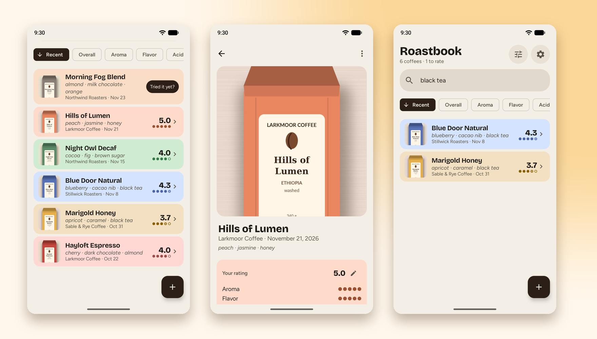
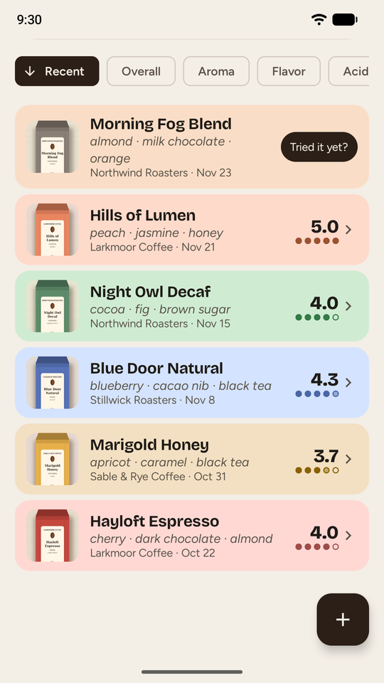
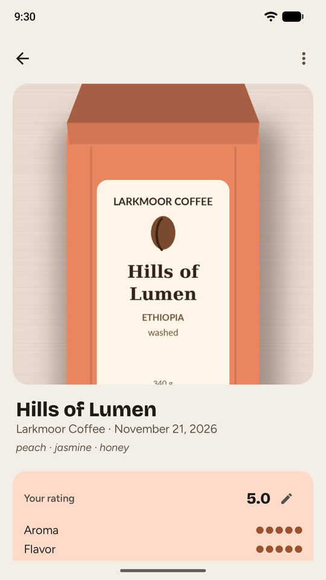
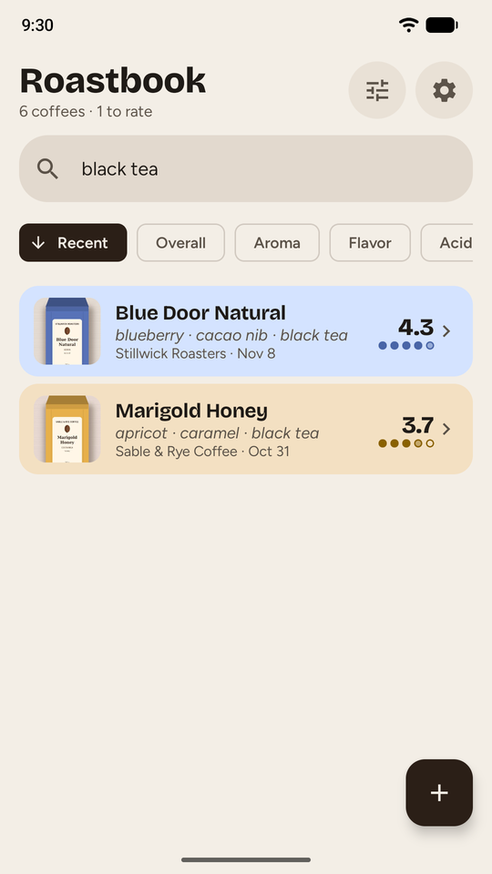
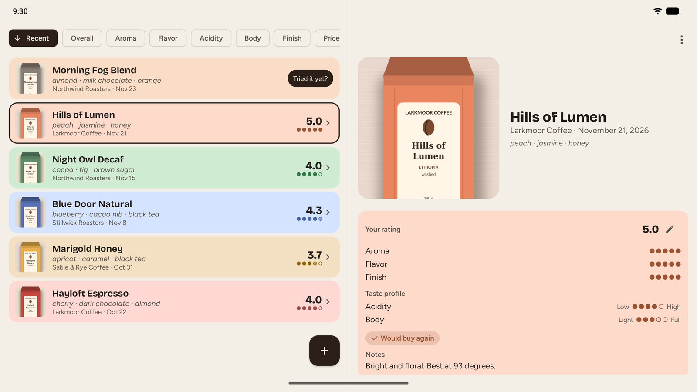

<p align="center">
  
</p>

<h1 align="center">Roastbook</h1>

<p align="center"><b>Your personal coffee journal.</b></p>

<p align="center">
  Photograph a bag of coffee, let your phone read the label, and rate it once you have brewed it.
  For Android phones, foldables and tablets.
</p>

<p align="center">
  <a href="../../releases/latest"><b>Download the latest release</b></a>
  &nbsp;·&nbsp; <a href="https://merrimentlabs.com/roastbook">merrimentlabs.com/roastbook</a>
  &nbsp;·&nbsp; <a href="https://merrimentlabs.com/privacy/roastbook">Privacy</a>
  &nbsp;·&nbsp; <a href="#install">Install</a>
</p>

<p align="center"><sub>Android 12 or newer · phones, foldables and tablets · no account, no ads, no server of ours · Apache License 2.0</sub></p>

<p align="center">
  
</p>

## What it does

A coffee bag says a lot: who roasted it, where it grew, how it was processed, what it should taste
like. Then the bag is gone. Roastbook keeps all of that, plus what you thought of it, so "that
roaster with the peach one" is a quick search a year later.

- **It reads the bag.** Take as many photos as you like (front, back, a pamphlet, the box). Text
  recognition runs on the phone, then an on-device language model turns the label into fields:
  roaster, coffee, origin, region, producer, process, varietal, elevation, roast and tasting notes.
- **Every field is a suggestion.** You can edit anything, and each entry says how it was read. A
  reread never overwrites a field you changed by hand.
- **You rate it when you know.** Aroma, flavor, acidity, body and finish, an overall score, notes,
  the price and whether you would buy it again. Pick a reminder when you log a bag, and get one
  second look a few days after your first rating.
- **You find it again.** Search by roaster, coffee or note; sort by date, any rating or price;
  filter to unrated coffees or ones you would buy again. Each row is tinted with its bag's colors.
- **Backups are yours.** Android's backup keeps the journal, and Roastbook can write a zip with
  full photos to a folder you choose, daily or on demand, and restore from it on a new phone.

## A look around

<table>
  <tr>
    <td></td>
    <td></td>
    <td></td>
  </tr>
  <tr>
    <td>The journal, each row tinted by its bag.</td>
    <td>A coffee's page.</td>
    <td>Search by a tasting note.</td>
  </tr>
  <tr>
    <td colspan="3"></td>
  </tr>
</table>

Every coffee, roaster and bag in these images is invented; the bags are drawn by a script
([tools/screenshots](tools/screenshots)).

## Your data

Your journal and photos stay on your device, in the app's private storage (if you turn on saving
bag photos to your gallery, those copies live in your photo library). Roastbook has no account,
no ads, no analytics of our own and no server of ours, so we receive nothing. Backups go only
where you send them.

These are all the places the app itself contacts, and when:

| Host | When | What it receives |
|---|---|---|
| Google's ML Kit and Play services | Always; it cannot be turned off | Diagnostic and usage metrics with identifiers for the device and installation. Google's list of that data contains no photos or text. |
| `generativelanguage.googleapis.com` | Only if you add your own Gemini API key | Under your key: the photos and recognized text of a bag the device could not read, and the roaster's and coffee's names when you tap Look up roaster. |
| `huggingface.co` (and the download servers it redirects to) | Only when you download the optional on-device reader | A request for the model file. |
| `api.github.com` | When you tap Check for updates, or weekly if you turn that on | A request for the latest release, with no account, device or app details. |

Links you tap (a roaster's site, a product page, a web search for the roaster, the release page,
the help and privacy pages) open in your browser; the app does not fetch them. The
[privacy policy](https://merrimentlabs.com/privacy/roastbook) has the details.

## Install

Download `roastbook-<version>.apk` from the [latest release](../../releases/latest) on a device with
Android 12 or newer, open it, and allow your browser or Files app to install apps when Android
asks. Installing from outside a store means updates come only when you install them; Android
refuses any update not signed with the same key as the copy you have.

Check the download before you install it: `SHA256SUMS` in each release lists the file's hash.
The easy check of the signature is `scripts/release.sh --verify roastbook-<version>.apk` from a
clone of this repository. It needs no key, but it does need `ANDROID_HOME` (or `ANDROID_SDK_ROOT`)
pointing at an Android SDK with build-tools 35 or newer, and `unzip`; it stops and says which is
missing. It checks the signature, compares the signing certificate with Roastbook's, and prints
the certificate SHA-256 in this form:

`D8:79:AD:13:90:76:D9:92:D6:37:CF:A9:E3:A4:6C:84:2C:9C:E1:99:0A:AC:2A:B6:5B:0F:D7:6E:97:76:38:E1`

To check by hand, run `apksigner verify --print-certs roastbook-<version>.apk`. It prints the
same value in lowercase without colons, on the line `Signer #1 certificate SHA-256 digest:`

`d879ad139076d992d637cfa9e3a46c842c9ce1990aac2ab65b0fd76e977638e1`

To hear about new versions: tap Settings, About, Check for updates (or turn on Check weekly
below it), add this repository to [Obtainium](https://github.com/ImranR98/Obtainium), or watch
the repository's releases on GitHub.

What the phone brings matters for reading bags. Phones whose system offers Gemini Nano read
labels on the device with no setup. Any phone with 8 GB of memory or more can download the
optional on-device reader, an open model (2.6 GB, once); where the phone has no built-in model it
reads bags, and where it has one, a switch in Settings can choose the reader instead. Both run
entirely on the device. Phones can also add their own Gemini API key, or rely on a guess from the
printed text, which the app marks as a guess. Everything else works the
same on every phone.

## How it's built

Roastbook is a single-module Kotlin app: Jetpack Compose with Material 3, one activity, Navigation
Compose, Hilt, Room for the journal and app-private files for photos. CameraX takes the photos;
ML Kit's subject segmentation crops the bag for the hero image, and its text recognition reads
every photo. [docs/ARCHITECTURE.md](docs/ARCHITECTURE.md) has the detail.

**Reading a bag on the device.** Reading is a state machine with a recorded source. It tries the
phone's built-in model (Gemini Nano through ML Kit GenAI), then the optional on-device reader
(Gemma 4 E2B running on [LiteRT-LM](https://github.com/google-ai-edge/LiteRT-LM)), then Gemini
with the user's key if there is one, and falls back to simple rules over the recognized text. A
built-in reading that is not the JSON asked for, or that names neither the roaster nor the coffee,
is checked against the on-device reader when it is downloaded, and the reading with more fields is
kept (on a tie, the reader's, when its first answer was valid JSON and the built-in answer was
not); a user can also choose the on-device reader outright.
Every step has a deadline and every read an attempt cap, and the trail of what each tier did is
stored with the coffee, so the app can say why a field came from where it did. The state lives in
Room, so a read survives the app being closed, and reads that don't need the foreground continue
in a WorkManager job. Writes from a read touch only the fields the read owns, inside a
transaction, so a rating or hand edit made mid-read survives it.

**Local-first storage and backup.** The journal is a Room database and the photos are files; there
is no server to sync with. Backups come in two tiers. Android Auto Backup carries a `VACUUM INTO`
snapshot of the database, thumbnails and preferences, adopted on a fresh install before Room
opens. The folder backup writes a zip with a manifest of SHA-256 digests. A restore is staged,
verified against the manifest, migrated through Room and swapped in with a journal, so a restore
killed halfway rolls back on the next start. The tests kill the process between the two renames
of a swap and restore over a read in progress. The Gemini key is encrypted with AES-GCM under an
Android Keystore key and kept out of both backup tiers.

**The license gate.** The in-app Open-source notices screen is checked like code. Tests fail when
a library listed there has no license text, when a shown version disagrees with the version
catalog, or when the bundled notice files are missing; the notices generator
(`scripts/third_party_notices.py`) refuses to write a partial file. The 2.6 GB model download is
pinned to a commit and a SHA-256.

**Tests.** 1177 JVM unit tests (Robolectric and Compose UI tests) cover every extraction branch,
the backup and restore paths, Room migrations across four exported schemas, the tap-only roaster
lookup, color contrast as numbers, the update check, the screens and the wording of every
string. CI fails if line coverage drops below 95% (`scripts/coverage.py` reports 98.8% today and
names each SDK adapter it leaves out, with the runtime it needs). The app has been walked on two
recent phones from different makers and on phone and tablet emulators. It also runs on a Googlebook,
on-device reading included, though that isn't a device it's made for: photographing a bag of coffee
with a laptop is as awkward as it sounds.

**How this is built.** I'm a product manager who builds. I decide what each app does, how it
should feel, and what it leaves out. The code is written with AI coding agents that I direct,
inside a process I designed: every change has to pass unit tests, a license audit and an
independent review before it lands, and I check the result on real devices before anything
ships. This repo starts from a clean snapshot of my private working repo, and each change after
that is carried over as its own commit. I write about how the process works at
[jessejohnston.ai](https://jessejohnston.ai).

## Build it yourself

You need JDK 21 and the Android SDK with platform 37 and its licenses accepted
(`sdkmanager --licenses`), with `ANDROID_HOME` set or `sdk.dir` in `local.properties`.

```sh
./gradlew assembleDebug
./gradlew testDebugUnitTest createDebugUnitTestCoverageReport lintDebug
python3 scripts/coverage.py --min 95
```

The first test run downloads Robolectric's Android runtime from Maven Central, so it needs a
network connection. A debug build works for anyone and is signed with your own debug key. Release
builds need a release key and stop on purpose without one; how releases are built, verified and
signed (including with your own key) is in [docs/RELEASING.md](docs/RELEASING.md). The scripts
that make the README images are in [tools/screenshots](tools/screenshots).

## Roadmap

Next:

- Insights: average scores by origin, process, roaster and roast level.
- A CSV export of the journal.

Not planned:

- Accounts, a server or sync between devices. Moving phones is a backup and a restore.
- Brew-by-brew logging. Roastbook keeps one rating per bag.
- Sharing or social features, and ordering from inside the app.
- Analytics, or an iOS version.
- Downloading or installing updates from inside the app. The update check only opens the release
  page.

## Contributing

Issues are welcome: bugs, labels the app misreads, ideas. Roastbook is maintained by one person,
so there is no support promise. Pull requests are read; a change that fits is applied in the
private working repository and carried back here as its own commit, credited to you. [CONTRIBUTING.md](CONTRIBUTING.md) has the
details, and [SECURITY.md](SECURITY.md) says how to report a security problem privately.

## License

Roastbook is licensed under the [Apache License 2.0](LICENSE). If you redistribute it or build on
it, keep the [NOTICE](NOTICE) file with your copy; it reads:

```
Roastbook
Copyright 2026 Jesse Johnston
Published by Merriment Labs (https://merrimentlabs.com)
```

The license gives no permission to use the Roastbook or Merriment Labs names (section 6). The app
shows the same notice at the top of its own license page.

The app bundles open-source libraries (Kotlin, AndroidX, Dagger and Hilt, Coil, OkHttp, LiteRT-LM
and others) and uses Google Play services and ML Kit, which are closed source, under Google's
terms. Their license texts and notices are in the app under Settings, About, Open-source notices.

The optional on-device reader downloads the Gemma 4 E2B model by Google
([litert-community/gemma-4-E2B-it-litert-lm](https://huggingface.co/litert-community/gemma-4-E2B-it-litert-lm)),
published under the Apache License 2.0. The app's fonts, Bricolage Grotesque and Figtree, are under
the SIL Open Font License 1.1; the license text is in [licenses/OFL.txt](licenses/OFL.txt).

## About

> Roastbook is made by [Merriment Labs](https://merrimentlabs.com), a one-person Android
> studio run by Jesse Johnston. Questions, bugs and ideas are welcome at
> [merrimentlabs.com/contact](https://merrimentlabs.com/contact) or
> hello@merrimentlabs.com.
>
> Copyright 2026 Jesse Johnston. Published by Merriment Labs.
